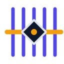

<div align="center">

<p align="center">
  
</p>

<h1>Looming: Enterprise Agent Engineering in One Self-Contained Bundle</h1>

<p>
One install gives an organization the whole agent lifecycle: a governed
model gateway, pluggable agent runtimes, organization-wide memory and a
unified tools/MCP/skills registry, isolated sandbox execution, and
issue-driven development pipelines across GitHub and self-hosted GitLab CE.
</p>

<p align="center">
  <a href="https://github.com/kikakkz/looming/actions/workflows/ci.yml?branch=main"></a>
  
  <a href="#license"></a>
</p>

<p align="center">
  <strong>
    <a href="#install">Install</a> ·
    <a href="#why-looming">Why Looming</a> ·
    <a href="#architecture">Architecture</a> ·
    <a href="#status">Status</a> ·
    <a href="#security">Security</a> ·
    <a href="#compared-with-other-tools">Compared</a> ·
    <a href="#documentation">Docs</a> ·
    <a href="#contributing">Contributing</a>
  </strong>
</p>

</div>

---

> Early development: repository conventions, CI gates, and the
> architecture record are in place (see the [decision index](.ai/memory/decisions/)),
> and the first components have landed — gateway, identity, topology, the
> `looming` CLI, and the platform/go kit — each built issue by issue.

---

## Table of Contents

- [Install](#install)
- [Why Looming?](#why-looming)
- [Architecture](#architecture)
- [Status](#status)
- [How Looming Works](#how-looming-works)
- [Security](#security)
- [Compared With Other Tools](#compared-with-other-tools)
- [Documentation](#documentation)
- [Contributing](#contributing)
- [License](#license)

---

## Install

> **The installer contract changed from v0.1.** The v0.1 installer
> brought up the whole cluster in one command (`install.sh --email …
> --engine-url …` generated a topology and converged the bundle on the
> spot). [AD-42](.ai/memory/decisions/0042-installer-shrinks-to-cli-only-agentic.md)
> retired that form: **one command now installs the tool**, and cluster
> bring-up is staged, driven by the `looming` CLI itself. The agentic
> `looming setup` — an interview, an advisor-proposed topology,
> human-confirmed, staged bootstrap (#191, slice S2a) — is the planned
> bring-up experience; today you bring the cluster up with
> `looming apply --config`.

### 1. Install the CLI

Prerequisites: a Linux host with Docker Engine; when the Docker Compose
plugin is missing the installer attempts to install it — under sudo it
promotes the invoking user's copy to the system plugin dir if present
(validating it first), otherwise it downloads the binary from the
docker/compose release — and points at the manual-install docs if none
of that works. Download the script first, then run it — piping `curl`
straight into `bash` would execute whatever arrived, and a failed or
truncated download could half-run or fail silently:

```bash
( tmp="$(mktemp)" \
    && curl -fsSL -o "$tmp" https://github.com/kikakkz/looming/releases/latest/download/install.sh \
    && bash "$tmp"
  rc=$?; rm -f "$tmp"; exit "$rc" )
```

The subshell surfaces the install's exit code without closing your
interactive shell; a failed download still cleans up and reports
failure (`rc` captures the `&&` chain's exit status either way). The
`releases/latest/download/install.sh` permalink always resolves to the
newest release's asset, so this never pins a version and never needs
editing per release.

The installer consumes **published release artifacts only**: it
downloads the released `looming` CLI binary (arch-matched) and places
it at `~/.local/bin` — override the destination with `--prefix <dir>`
(the directory is created when absent; root-owned system directories
are refused for non-root users). Nothing else is written: no topology,
no secrets, no converge. There is no source-build install path —
developing from source is its own workflow (a checkout + the repo's
dev tooling).

- `--version vX.Y.Z` selects the released CLI; the default resolves the
  latest release. The one-liner above already downloads the installer
  from the latest release's assets, so script and binary move together —
  pin both by taking the script from that release's assets (download
  first, then run, same reason as above):
  `( tmp="$(mktemp)" && curl -fsSL -o "$tmp" https://github.com/kikakkz/looming/releases/download/vX.Y.Z/install.sh && bash "$tmp" --version vX.Y.Z; rc=$?; rm -f "$tmp"; exit "$rc" )` (subshell form, same reason as above)
- Re-running is safe: the same destination just receives the binary
  again, verified with `looming --version` before the script reports
  success.
- Full flags: download the script and run it with `--help` (a
  self-contained form, since the one-liner above already deleted its
  temporary copy):
  `( tmp="$(mktemp)" && curl -fsSL -o "$tmp" https://github.com/kikakkz/looming/releases/latest/download/install.sh && bash "$tmp" --help; rc=$?; rm -f "$tmp"; exit "$rc" )`

### 2. Bring up the cluster

Bring-up is `looming apply --config <topology.yaml>`: write a topology
file describing your cluster and converge it. A minimal single-host
topology for the current component set (gateway, identity, topology,
plus the bundle's state Postgres):

```yaml
version: 1
access: {mode: public, transport: direct, endpoint: "127.0.0.1"}
cluster: {name: my cluster}
bootstrap: {admin_email: admin@example.com}
state:
  postgres:
    image: postgres:16-alpine
    env_file: /etc/looming/postgres.env   # POSTGRES_USER / POSTGRES_PASSWORD
    data_dir: /etc/looming/pgdata
    port: 15432
hosts:
  - {id: local, address: 127.0.0.1}
placements:
  - component: gateway-front
    host: local
    ports: {http: 18080}
    config:
        upstream: "http://host.docker.internal:11434/v1"  # your OpenAI-compatible engine
        upstream_insecure: "1"                             # required for a plain-http upstream
        identity_url: "http://identityd:18081"
        identity_insecure: "1"
    env_file: /etc/looming/gateway.env    # GATEWAY_TOPOLOGY_TOKEN / GATEWAY_IDENTITY_TOKEN
    extra_hosts: ["host.docker.internal:host-gateway"]
  - component: identityd
    host: local
    ports: {http: 18081}
    config:
        database_url: "postgres://looming:<password>@bundle-postgres:5432/identity?sslmode=disable"
    env_file: /etc/looming/identityd.env  # IDENTITY_BOOTSTRAP_KEY / IDENTITY_GATEWAY_TOKEN / IDENTITY_KEY_MASTER_KEY
  - component: topologyd
    host: local
    ports: {http: 18082}
    config:
        database_url: "postgres://looming:<password>@bundle-postgres:5432/topology?sslmode=disable"
    env_file: /etc/looming/topologyd.env  # TOPOLOGY_SERVICE_TOKEN
```

The paths above are the conventional system location — any directory
works; create it and write the env files before applying. The env files
carry the services' secrets — write them yourself (all
`0600`, values from `openssl rand -hex 24`; `IDENTITY_GATEWAY_TOKEN`
and `GATEWAY_IDENTITY_TOKEN` are the paired gateway↔identity token,
`TOPOLOGY_SERVICE_TOKEN` and `GATEWAY_TOPOLOGY_TOKEN` the paired
topology↔gateway one). Point `upstream` at any OpenAI-compatible engine
you run (Ollama, llama.cpp, vLLM, …): the URL must be reachable from
the component containers — containers reach the host through the
`host.docker.internal:host-gateway` alias, so a `localhost`/`127.0.0.1`
engine URL must be written as `host.docker.internal` (and only works
single-node; multi-host deployments should use the engine host's LAN IP
or DNS name).

```bash
looming apply --config topology.yaml
```

`apply` validates the topology, renders the per-host compose files, and
converges the first host — pulling the release-pinned component images
and printing the one-time bootstrap invite for the admin in
`bootstrap.admin_email`. The full topology schema lives in
[docs/architecture/topology-l1.md](docs/architecture/topology-l1.md).
Teardown: `docker compose -p looming down` (the Postgres data dir is
wherever the topology's `state.postgres.data_dir` points).

### 3. Join further hosts

On the first host, mint a one-time join token (the topology database
URL is the published state Postgres):

```bash
looming token create --role engine --ttl 24h \
  --database-url "postgres://looming:<password>@127.0.0.1:15432/topology?sslmode=disable"
```

On each new host: install the CLI (step 1), then join — the host
registers itself and converges what the topology places on it:

```bash
looming join http://<first-host>:18082 --token <token> --host-id <id> --address <ip>
```

---

## Why Looming?

Coding agents have won. Claude Code, Codex, Kimi, and their kin now write a
large share of real production code — but every organization is left to
assemble the same surrounding machinery by hand:

- a gateway with auth, quota, and audit between developers and model APIs
- isolated, disposable execution environments for unattended agents
- organizational memory that outlives any single session or employee
- a curated, scanned registry of tools, MCP servers, and skills
- pipelines where agents pick up real issues and deliver reviewable MRs

Stripe, Shopify, Spotify, and Coinbase each spent years building this glue
in-house. Looming productizes it: the same patterns, installable as one
bundle, governable as one control plane.

Looming adds the missing organization layer underneath the agents you
already use:

| Concern | What Looming provides |
|---|---|
| Model access | Stateless OpenAI-compatible gateway: faithful forwarding (streaming/retry semantics stay with the client), API keys; OIDC enterprise SSO (identity slices), per-user quota, append-only interaction log, pluggable risk interception |
| Agent runtime | Provider system with capability levels L0–L3; bundle a default or bring your own Codex, Kimi Code, goose, and others |
| Memory | Unified memory (org/project/user scopes, review-gated writes) |
| Registry | A curated, scanned registry for MCP servers, skills, and tools (review-gated admission) |
| Execution | Elastic sandbox pool (Kubernetes + gVisor, warm pool): no production credentials, no egress except allowlist, disposable per run |
| Workflows | Issue-driven development across GitHub and bundled GitLab CE: agents take issues, plans land in the issue thread, MRs pass the same CI gates as humans |
| Quality | Verifier-first: CI guards known failures deterministically; the judge discovers new failures and promotes them into checks, memory, and tooling |

The goal is not to become another coding agent. Looming is the
infrastructure an organization runs *underneath* whichever agents its
developers prefer.

---

## Architecture

**Batteries included, everything swappable.** Every major component is a
slot behind a small versioned interface; the bundle ships the combination
we consider best, and each slot can be replaced with your own or an
open-source alternative.

```text
┌─────────────────────────── Looming bundle ─────────────────────────────────┐
│                                                                            │
│  Control plane (product core, not pluggable)                               │
│                                                                            │
│  ┌─────────────────────────────────────────────────────────────┐           │
│  │ blueprint orchestrator · event log · issue protocol · judge │           │
│  └─────────────────────────────────────────────────────────────┘           │
│                                                                            │
│  Pluggable slots (default in bundle ▸ alternatives)                        │
│                                                                            │
│  ┌────────────┐ ┌─────────────┐ ┌──────────┐ ┌───────────────────┐         │
│  │ gateway    │ │ runtime     │ │ memory   │ │ registry          │         │
│  │ Go gateway │ │ ▸ providers │ │ ▸ mem0 / │ │ ToolHive ▸        │         │
│  │ ▸agentgw?  │ │ (L0–L3)     │ │ Graphiti │ │ mcp-context-forge │         │
│  └────────────┘ └─────────────┘ └──────────┘ └───────────────────┘         │
│                                                                            │
│  ┌──────────────┐ ┌───────────┐ ┌────────────┐                             │
│  │ sandbox      │ │ SCM       │ │ decision   │                             │
│  │ Docker fleet │ │ GitLab CE │ │ engine     │                             │
│  │ ▸K8s+gVisor  │ │ +GitHub   │ │ rules+Laya │                             │
│  └──────────────┘ └───────────┘ └────────────┘                             │
│                                                                            │
└────────────────────────────────────────────────────────────────────────────┘
```

The control plane — blueprint orchestration, the append-only event log,
and the issue protocol — is deliberately *not* pluggable: it is the
product. Everything else is a swappable component with a conformance
contract.

---

## Status

In place:

- Repository operating contract ([AGENTS.md](AGENTS.md)) and CI gate
  (`make ci-gate`: branch and lockfile validation, tool tests, trailer
  policy, ADR check, skill and index validation, semgrep rule pack,
  shell lint, Go lint and tests)
- Issue-driven process: kind/area taxonomy (Kubernetes convention),
  templates, DCO + AI attribution policy, CodeRabbit review loop owned by
  the repo's own pr-watch tooling
- Agent asset directory (`.ai/`): sha-pinned external methodology skills,
  10 self-authored skills, memory bank with accepted decisions
- Methodology stack: DDD structure, TDD with complexity budgets, the
  four-layer testing policy, and the two-plane rule (repository management
  vs product capabilities)
- Landed components (Go, AD-34 layout): model gateway (slices through D,
  #114) · identity (slices A–E, incl. OIDC enterprise authn) · topology
  (T1–T3: apply/join/guide) · the `looming` CLI (CLI-0/1: user face +
  admin face, incl. `genesis set|sync|status` and `topology facts pull`)
  · the platform/go kit with the management-agent advisor (slices
  1.1–1.3, #144)

Decided, being built:

- `looming` CLI slice CLI-2 — remaining agent adapters (codex, claude)
  + the component `/healthz` status contract (#108)

Planned slots (see [decisions](.ai/memory/decisions.md)):

- ToolHive-based registry, sandbox pool operator, GitLab CE adapter,
  decision-engine integration

---

## How Looming Works

In one paragraph — the target state; the Status section above tracks
what is operational today: a developer @mentions an agent in the CLI (IM
entry comes later) and hands it an issue; the agent's model calls route through
the organization's gateway, so quota, audit, and risk interception apply
uniformly; it works in an isolated, disposable sandbox whose credentials
are scoped to what that developer may touch — never more; it reads
organizational memory and uses only registry-approved tools; its output
lands in the SCM as that developer's own contribution and passes the
organization's own CI exactly like human work; a judge reviews beyond
what deterministic checks can see, and what it learns flows back into the
org's checks, its memory, and its tool registry.

The authoritative record of the architecture is the
[decision index](.ai/memory/decisions/); the live design discussion lives
in #66; long-form documents land in [docs/](docs/).

---

## Security

- Sandboxes are disposable and deny-by-default: no production credentials,
  no network egress except an allowlist (SCM hosts and package registries).
- Credentials are minted per run, scoped to a single repository, and never
  enter logs; requests carrying credentials outside their allowed channel
  are rejected before forwarding.
- External skills and MCP servers are sha-pinned and license-checked in CI;
  MCP servers additionally require an admission security scan.
- (Design intent, settled in the architecture discussion #66 — not yet
  implemented.) Agents act with the invoking user's delegated permissions
  — never a service super-account: two token modes (delegated user token vs
  service token for sync), a policy check before every tool dispatch
  (fail-closed, human-approval as a first-class outcome), and retrieval
  trimmed by source ACLs so unauthorized content never reaches a model.
  Every tool decision is audited with both identities — who acted, via
  which agent.
- AI contributions are disclosed with `Assisted-by:` / `Generated-by:`
  trailers; a human signs DCO and takes responsibility for every merge.

---

## Compared With Other Tools

| Tool | What it is | Where Looming differs |
|---|---|---|
| LiteLLM / one-api | Model gateway and proxy | Looming keeps the gateway and adds the organization layer around it: sandboxes, memory, registry, issue-driven pipelines |
| Dify / Coze | Agent application platforms | Looming is infrastructure you run yourself — SCM-native, issue-native, no hosted SaaS dependency |
| Devin / coding-agent products | A specific agent you adopt | Looming orchestrates whichever agents you already use, behind one governance plane |
| GitHub / GitLab | Code hosting and CI | Looming is the agent control plane that works across both, keeping repo CI native while running its own pipeline |

---

## Documentation

- [AGENTS.md](AGENTS.md) — operating contract for humans and AI agents
- [CONTRIBUTING.md](.github/CONTRIBUTING.md) — DCO, AI contribution policy, dev setup
- [.ai/memory/decisions/](.ai/memory/decisions/) — accepted architecture decisions (one file per AD, generated index)
- [docs/](docs/) — long-form design documents (land via issues)

---

## Contributing

Every change starts as an issue, lands as a PR with its own CI, and —
for humans — carries a DCO sign-off. AI assistance is welcome and must be
disclosed with trailers. See [CONTRIBUTING.md](.github/CONTRIBUTING.md).

## Topics

`agent-engineering` `ai-agents` `model-gateway` `sandbox` `mcp` `agent-skills`
`issue-driven-development` `gitlab-ce` `kubernetes` `enterprise`

## License

[Apache-2.0](LICENSE)

