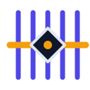

<div align="center">

<p align="center">
  
</p>

<h1>Looming: Enterprise Agent Engineering in One Self-Contained Bundle</h1>

<p>
One install gives an organization the whole agent lifecycle: a governed
model gateway, pluggable agent runtimes, organization-wide memory and a
unified tools/MCP/skills registry, isolated sandbox execution, and
issue-driven development pipelines across GitHub and self-hosted GitLab CE.
</p>

<p align="center">
  <a href="https://github.com/kikakkz/looming/actions/workflows/ci.yml?branch=main"></a>
  
  <a href="#license"></a>
</p>

<p align="center">
  <strong>
    <a href="#install">Install</a> ·
    <a href="#why-looming">Why Looming</a> ·
    <a href="#architecture">Architecture</a> ·
    <a href="#status">Status</a> ·
    <a href="#security">Security</a> ·
    <a href="#compared-with-other-tools">Compared</a> ·
    <a href="#documentation">Docs</a> ·
    <a href="#contributing">Contributing</a>
  </strong>
</p>

</div>

---

> Early development: repository conventions, CI gates, and the
> architecture record are in place (see the [decision index](.ai/memory/decisions/)),
> and the first components have landed — gateway, identity, topology, the
> `looming` CLI, and the platform/go kit — each built issue by issue.

---

## Install

Prerequisites: a Linux host with Docker Engine and the Docker Compose
plugin — the installer preflights both but does not install them.
Point it at any OpenAI-compatible engine you run (Ollama, llama.cpp,
vLLM, …). Download the script first, then run it — piping `curl`
straight into `bash` would execute whatever arrived, and a failed or
truncated download could half-run or fail silently:

```bash
tmp="$(mktemp)" \
  && curl -fsSL -o "$tmp" https://raw.githubusercontent.com/kikakkz/looming/main/scripts/install.sh \
  && bash "$tmp" \
       --email admin@example.com \
       --engine-url http://host.docker.internal:11434/v1
rc=$?; rm -f "$tmp"
```

The installer consumes **published release artifacts only**: it
downloads the released `looming` CLI and the bundle's pinned manifest,
then converges the bundle with `looming apply`, which pulls the pinned
component images. There is no source-build install path — developing
from source is its own workflow (a checkout + the repo's dev tooling).

- `--version vX.Y.Z` selects the released bundle the installer
  converges; the default resolves the latest release. The one-liner
  above downloads `install.sh` from `main`, so the installer itself
  tracks main — to pin the installer to a release as well, take the
  script from that release's assets (download first, then run, same
  reason as above):
  `tmp="$(mktemp)" && curl -fsSL -o "$tmp" https://github.com/kikakkz/looming/releases/download/vX.Y.Z/install.sh && bash "$tmp" --email admin@example.com --engine-url ...; rc=$?; rm -f "$tmp"`
- Re-running is safe. The installer owns only the topology file's
  `bundle:` block: a newer version rewrites just that block and the
  manifest file (your edits — ports, engine config, placements —
  survive), and the same version is a converge-only re-run.
- Teardown: `docker compose -p looming down` (the Postgres data dir is
  `/etc/looming/pgdata`).

Full flags: `scripts/install.sh --help`.

---

## Table of Contents

- [Install](#install)
- [Why Looming?](#why-looming)
- [Architecture](#architecture)
- [Status](#status)
- [How Looming Works](#how-looming-works)
- [Security](#security)
- [Compared With Other Tools](#compared-with-other-tools)
- [Documentation](#documentation)
- [Contributing](#contributing)
- [License](#license)

---

## Why Looming?

Coding agents have won. Claude Code, Codex, Kimi, and their kin now write a
large share of real production code — but every organization is left to
assemble the same surrounding machinery by hand:

- a gateway with auth, quota, and audit between developers and model APIs
- isolated, disposable execution environments for unattended agents
- organizational memory that outlives any single session or employee
- a curated, scanned registry of tools, MCP servers, and skills
- pipelines where agents pick up real issues and deliver reviewable MRs

Stripe, Shopify, Spotify, and Coinbase each spent years building this glue
in-house. Looming productizes it: the same patterns, installable as one
bundle, governable as one control plane.

Looming adds the missing organization layer underneath the agents you
already use:

| Concern | What Looming provides |
|---|---|
| Model access | Stateless OpenAI-compatible gateway: faithful forwarding (streaming/retry semantics stay with the client), API keys; OIDC enterprise SSO (identity slices), per-user quota, append-only interaction log, pluggable risk interception |
| Agent runtime | Provider system with capability levels L0–L3; bundle a default or bring your own Codex, Kimi Code, goose, and others |
| Memory | Unified memory (org/project/user scopes, review-gated writes) |
| Registry | A curated, scanned registry for MCP servers, skills, and tools (review-gated admission) |
| Execution | Elastic sandbox pool (Kubernetes + gVisor, warm pool): no production credentials, no egress except allowlist, disposable per run |
| Workflows | Issue-driven development across GitHub and bundled GitLab CE: agents take issues, plans land in the issue thread, MRs pass the same CI gates as humans |
| Quality | Verifier-first: CI guards known failures deterministically; the judge discovers new failures and promotes them into checks, memory, and tooling |

The goal is not to become another coding agent. Looming is the
infrastructure an organization runs *underneath* whichever agents its
developers prefer.

---

## Architecture

**Batteries included, everything swappable.** Every major component is a
slot behind a small versioned interface; the bundle ships the combination
we consider best, and each slot can be replaced with your own or an
open-source alternative.

```text
┌─────────────────────────── Looming bundle ─────────────────────────────────┐
│                                                                            │
│  Control plane (product core, not pluggable)                               │
│                                                                            │
│  ┌─────────────────────────────────────────────────────────────┐           │
│  │ blueprint orchestrator · event log · issue protocol · judge │           │
│  └─────────────────────────────────────────────────────────────┘           │
│                                                                            │
│  Pluggable slots (default in bundle ▸ alternatives)                        │
│                                                                            │
│  ┌────────────┐ ┌─────────────┐ ┌──────────┐ ┌───────────────────┐         │
│  │ gateway    │ │ runtime     │ │ memory   │ │ registry          │         │
│  │ Go gateway │ │ ▸ providers │ │ ▸ mem0 / │ │ ToolHive ▸        │         │
│  │ ▸agentgw?  │ │ (L0–L3)     │ │ Graphiti │ │ mcp-context-forge │         │
│  └────────────┘ └─────────────┘ └──────────┘ └───────────────────┘         │
│                                                                            │
│  ┌──────────────┐ ┌───────────┐ ┌────────────┐                             │
│  │ sandbox      │ │ SCM       │ │ decision   │                             │
│  │ Docker fleet │ │ GitLab CE │ │ engine     │                             │
│  │ ▸K8s+gVisor  │ │ +GitHub   │ │ rules+Laya │                             │
│  └──────────────┘ └───────────┘ └────────────┘                             │
│                                                                            │
└────────────────────────────────────────────────────────────────────────────┘
```

The control plane — blueprint orchestration, the append-only event log,
and the issue protocol — is deliberately *not* pluggable: it is the
product. Everything else is a swappable component with a conformance
contract.

---

## Status

In place:

- Repository operating contract ([AGENTS.md](AGENTS.md)) and CI gate
  (`make ci-gate`: branch and lockfile validation, tool tests, trailer
  policy, ADR check, skill and index validation, semgrep rule pack,
  shell lint, Go lint and tests)
- Issue-driven process: kind/area taxonomy (Kubernetes convention),
  templates, DCO + AI attribution policy, CodeRabbit review loop owned by
  the repo's own pr-watch tooling
- Agent asset directory (`.ai/`): sha-pinned external methodology skills,
  10 self-authored skills, memory bank with accepted decisions
- Methodology stack: DDD structure, TDD with complexity budgets, the
  four-layer testing policy, and the two-plane rule (repository management
  vs product capabilities)
- Landed components (Go, AD-34 layout): model gateway (slices through D,
  #114) · identity (slices A–E, incl. OIDC enterprise authn) · topology
  (T1–T3: apply/join/guide) · the `looming` CLI (CLI-0/1: user face +
  admin face, incl. `genesis set|sync|status` and `topology facts pull`)
  · the platform/go kit with the management-agent advisor (slices
  1.1–1.3, #144)

Decided, being built:

- `looming` CLI slice CLI-2 — remaining agent adapters (codex, claude)
  + the component `/healthz` status contract (#108)

Planned slots (see [decisions](.ai/memory/decisions.md)):

- ToolHive-based registry, sandbox pool operator, GitLab CE adapter,
  decision-engine integration

---

## How Looming Works

In one paragraph — the target state; the Status section above tracks
what is operational today: a developer @mentions an agent in the CLI (IM
entry comes later) and hands it an issue; the agent's model calls route through
the organization's gateway, so quota, audit, and risk interception apply
uniformly; it works in an isolated, disposable sandbox whose credentials
are scoped to what that developer may touch — never more; it reads
organizational memory and uses only registry-approved tools; its output
lands in the SCM as that developer's own contribution and passes the
organization's own CI exactly like human work; a judge reviews beyond
what deterministic checks can see, and what it learns flows back into the
org's checks, its memory, and its tool registry.

The authoritative record of the architecture is the
[decision index](.ai/memory/decisions/); the live design discussion lives
in #66; long-form documents land in [docs/](docs/).

---

## Security

- Sandboxes are disposable and deny-by-default: no production credentials,
  no network egress except an allowlist (SCM hosts and package registries).
- Credentials are minted per run, scoped to a single repository, and never
  enter logs; requests carrying credentials outside their allowed channel
  are rejected before forwarding.
- External skills and MCP servers are sha-pinned and license-checked in CI;
  MCP servers additionally require an admission security scan.
- (Design intent, settled in the architecture discussion #66 — not yet
  implemented.) Agents act with the invoking user's delegated permissions
  — never a service super-account: two token modes (delegated user token vs
  service token for sync), a policy check before every tool dispatch
  (fail-closed, human-approval as a first-class outcome), and retrieval
  trimmed by source ACLs so unauthorized content never reaches a model.
  Every tool decision is audited with both identities — who acted, via
  which agent.
- AI contributions are disclosed with `Assisted-by:` / `Generated-by:`
  trailers; a human signs DCO and takes responsibility for every merge.

---

## Compared With Other Tools

| Tool | What it is | Where Looming differs |
|---|---|---|
| LiteLLM / one-api | Model gateway and proxy | Looming keeps the gateway and adds the organization layer around it: sandboxes, memory, registry, issue-driven pipelines |
| Dify / Coze | Agent application platforms | Looming is infrastructure you run yourself — SCM-native, issue-native, no hosted SaaS dependency |
| Devin / coding-agent products | A specific agent you adopt | Looming orchestrates whichever agents you already use, behind one governance plane |
| GitHub / GitLab | Code hosting and CI | Looming is the agent control plane that works across both, keeping repo CI native while running its own pipeline |

---

## Documentation

- [AGENTS.md](AGENTS.md) — operating contract for humans and AI agents
- [CONTRIBUTING.md](.github/CONTRIBUTING.md) — DCO, AI contribution policy, dev setup
- [.ai/memory/decisions/](.ai/memory/decisions/) — accepted architecture decisions (one file per AD, generated index)
- [docs/](docs/) — long-form design documents (land via issues)

---

## Contributing

Every change starts as an issue, lands as a PR with its own CI, and —
for humans — carries a DCO sign-off. AI assistance is welcome and must be
disclosed with trailers. See [CONTRIBUTING.md](.github/CONTRIBUTING.md).

## Topics

`agent-engineering` `ai-agents` `model-gateway` `sandbox` `mcp` `agent-skills`
`issue-driven-development` `gitlab-ce` `kubernetes` `enterprise`

## License

[Apache-2.0](LICENSE)

